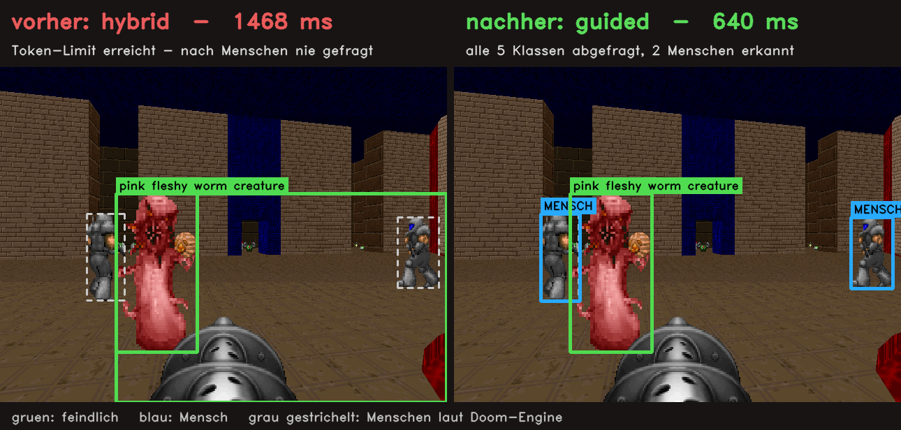
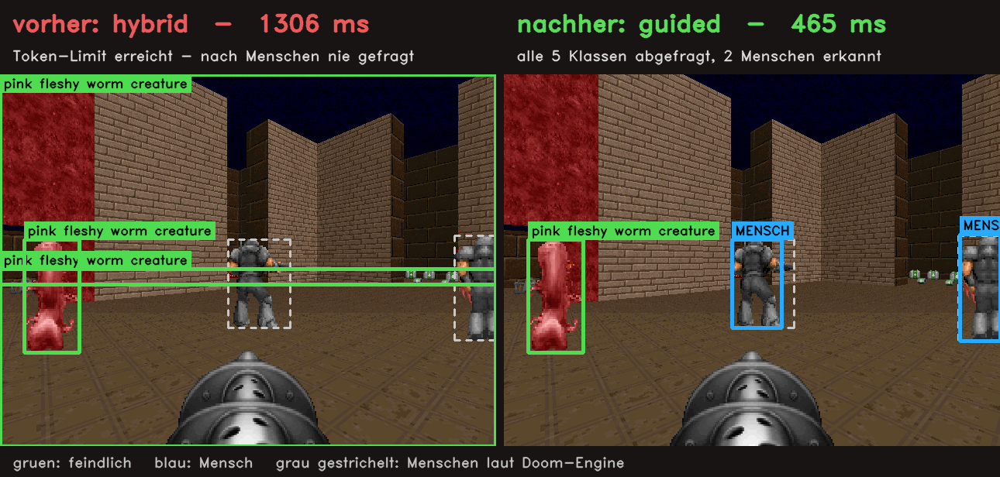
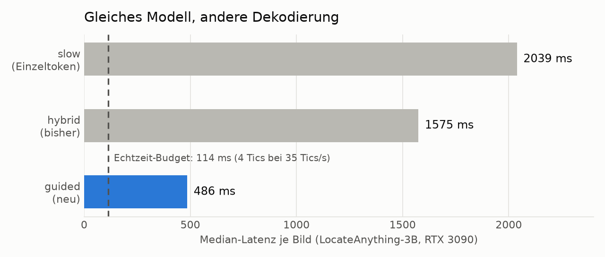
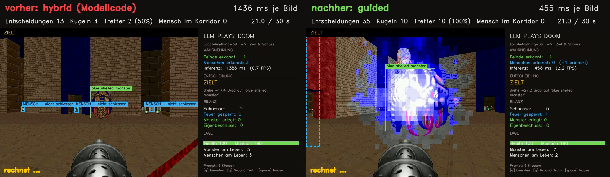
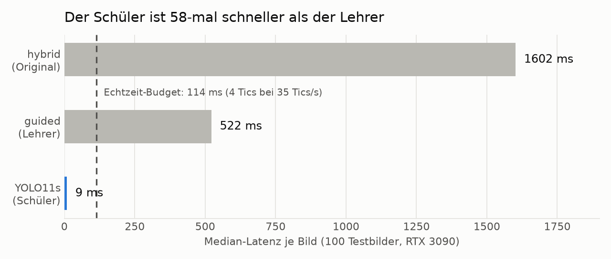
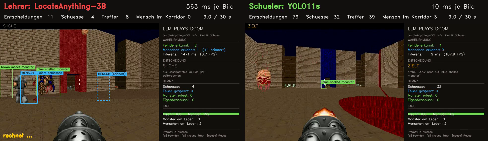
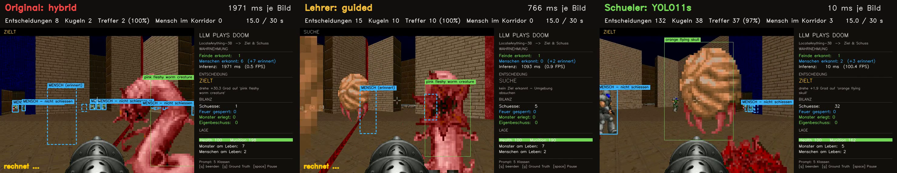
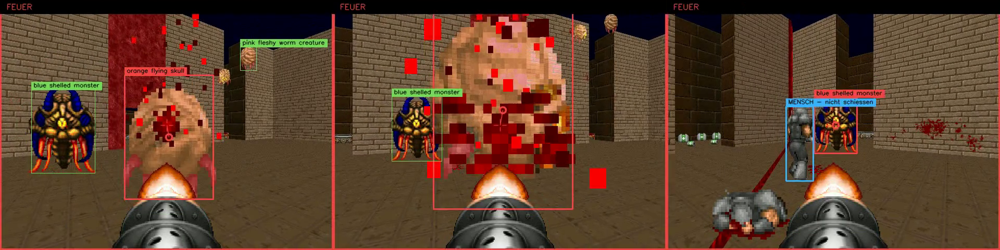

# Von 1,6 Sekunden auf 10 Millisekunden: Doom in Echtzeit

*Teil 1: Wie eine eigene Dekodierschleife LocateAnything-3B von 1,6 s auf 0,5 s
pro Bild bringt, und warum der Standardmodus des Modells Menschen übersehen hat.
Teil 2: Wie das große Modell zum Lehrer eines kleinen YOLO wird, das in 10 ms
mehr erkennt als sein Lehrer.*



## Die Ausgangsfrage

Der Doom-Agent dieses Projekts sieht das Spielbild durch NVIDIA LocateAnything-3B:
Bild und Textprompt rein, Bounding Boxes raus. Er zielt nur auf Monster und sperrt
das Feuer, sobald ein Mensch in der Schusslinie steht. Das funktioniert, aber
langsam: rund 1,5 Sekunden pro Bild. Echtzeit-Doom läuft mit 35 Tics pro Sekunde.
Bei vier Tics pro Aktion bleiben dem Agenten **114 ms**.

Die erste Idee war ein kleines Entscheidungsmodell wie *Tev1* (4B, Ollama).
Die Messung hat sie schnell erledigt:

| Schritt | Zeit pro Bild |
|---|---|
| LocateAnything: Boxen finden | ~1400 ms |
| Entscheiden: Ziel wählen, Korridor prüfen | < 1 ms |

Die Entscheidung ist reine Geometrie und kostet praktisch nichts. Ein Sprachmodell
an dieser Stelle macht den Agenten langsamer und unzuverlässiger, und Tev1 kann
ohnehin keine Bilder lesen. Die Zeit steckt vollständig im Sehen.

## Wohin die 1,4 Sekunden gehen

LocateAnything ist ein Sprachmodell, das Boxen als Text schreibt:

```
<ref>pink fleshy worm creature</ref><box><753><448><838><656></box>...
```

Aufgeschlüsselt: ~215 ms für das Einlesen von Bild und Prompt (Prefill), der Rest
für das Schreiben der Antwort, etwa 40 ms pro Vorwärtsschritt. Im Standardmodus
`hybrid` sagt das Modell mehrere Tokens auf einmal vorher. Eine ganze Box passt
in einen Schritt.

Auffällig war: **Jede einzelne Antwort lief bis zum Limit von 96 Tokens.** Auch mit
512 Tokens Spielraum endete keine. So sieht das aus:

```
<ref>pink fleshy worm creature</ref><box><260><377><441><850></box>
<box><260><377><999><1000></box><box><260><377><999><1000></box>
<box><260><377><999><1000></box><box><260><377><999><1000></box> ... (bis zum Limit)
```

Das Modell hängt in einer Schleife und wiederholt dieselbe Box. Die Klassen werden
in Prompt-Reihenfolge abgearbeitet, und die Menschen-Klasse steht hinten. Wer in der
Schleife hängt, kommt dort nie an.

Gezählt auf 24 Testbildern: **In 8 Bildern hat der Hybridmodus nie nach Menschen
gefragt.** 6 davon enthielten tatsächlich Marines, zusammen 10 Stück. Für die
Sicherheitslogik des Agenten existierten sie nicht. Im Titelbild oben kommt noch
etwas hinzu: Die Box in der Schleife ist riesig und als Monster gelabelt, und
ein Marine steht mitten darin.



Der langsame Einzeltoken-Modus (`slow`) zeigt das Problem nicht. Er endet sauber
nach etwa 67 Tokens, braucht dafür aber über 2 Sekunden.

## Die Lösung: Struktur vorgeben, Schiedsrichter umsonst

Die neue Dekodierung `guided` (in `src/detector.py`) baut die Steuerschleife des
Modells nach und verändert zwei Dinge:

**1. Die Klassen gibt der Agent vor, nicht das Modell.** Die Antwortstruktur ist
bekannt: jede Klasse in Prompt-Reihenfolge, dann ihre Boxen oder `<box>None</box>`.
Die Schleife setzt `<ref>Klasse</ref>` selbst ein. Diese Tokens laufen im nächsten
Vorwärtsschritt einfach mit und kosten nichts. Jede Klasse kommt garantiert an die
Reihe.

**2. Ein Schiedsrichter entscheidet, ob noch eine Box kommt.** Die Mehrtoken-Vorhersage
liefert immer eine Box, auch wenn keine mehr da ist. Das sind die Phantome entlang
der Horizontlinie und die Schleife. Im selben Vorwärtsschritt steht aber auch die
gewöhnliche Einzeltoken-Vorhersage zur Verfügung, an der Position des letzten
echten Tokens. Sie beantwortet die Frage „folgt noch `<box>`?" so zuverlässig wie
der langsame Modus. Der Schiedsrichter kostet also keine Rechenzeit, er liest nur
eine Zeile Logits, die ohnehin berechnet wird.

Im Ergebnis bekommt man die Struktur des langsamen Modus mit der Geschwindigkeit
der Mehrtoken-Vorhersage. Auf 10 Bildern stimmte `guided` in 9 Fällen Box für Box
mit `slow` überein.



## Was es bringt, gemessen gegen die Doom-Engine

Die Engine kennt die echten Boxen aller Figuren. `src/eval_detector.py`, 24 Bilder,
72 Figuren, RTX 3090:

| Dekodierung | Monster erkannt | Menschen erkannt | Mensch als Monster | ms je Bild |
|---|---|---|---|---|
| hybrid (bisher) | **61 %** | 57 % | 0 % | 1575 |
| slow | 45 % | 79 % | 4 % | 2039 |
| guided, Schwelle 0,5 | 48 % | 79 % | 4 % | 457 |
| **guided, Schwelle 0,05** | 52 % | **86 %** | **0 %** | **486** |
| guided, Schwelle 0,01 | 59 % | 86 % | 0 % | 1061 |

Die Schwelle ist die Mindestwahrscheinlichkeit, ab der der Schiedsrichter eine
weitere Box zulässt. Bei 0,05 liegt der beste Kompromiss, das ist jetzt der Default.

**3,2× schneller als bisher, und 86 % statt 57 % der Menschen erkannt.**

## Im Spiel: dieselben 30 Sekunden

Ein normales Aufnahmevideo verschleiert die Latenz, weil das Spiel steht, solange
das Modell rechnet. Für den Vergleich läuft die Welt deshalb weiter: Solange die
Inferenz dauert, laufen die Tics ohne Eingabe weiter, und der Agent handelt danach
auf Grundlage eines inzwischen veralteten Bildes. Das Video läuft mit 35 Bildern
pro Sekunde, also in echter Spielzeit (`src/compare_decoding.py`).



Video: `posts/img/05_vergleich_echtzeit.mp4` (nicht im Repository, Erzeugung siehe „Selbst nachmessen")

| | hybrid | guided |
|---|---|---|
| Entscheidungen in 30 s | 18 | **48** |
| Kugeln verschossen | 4 | 10 |
| Treffer | 2 | **10** |
| Schuss mit Mensch im Korridor | 0 | 0 |

Treffer sind um den Weckschuss bereinigt, siehe Abschnitt „Effektivität".

## Was nicht stimmt, oder noch nicht

* **Echtzeit ist das noch nicht.** 486 ms liegen gut viermal über dem Budget von
  114 ms. Die Spitzen gehen bis etwa 2 Sekunden, wenn viele Figuren im Bild sind:
  jede Box ist ein Vorwärtsschritt.
* **Der Hybridmodus findet mehr Monster** (61 % gegen 52 %). Ein Teil seiner
  „Phantom"-Boxen trifft eben doch etwas. Ehrlich gesagt ist das ein Tausch:
  weniger Monster, deutlich mehr Menschen.
* **24 Bilder sind wenig.** Die Richtung ist klar, die Prozente schwanken um einige
  Punkte.
* **Die Reihenfolge ist eine Annahme.** Das Modell hat die Klassen in jedem
  beobachteten Fall in Prompt-Reihenfolge abgearbeitet. Garantiert ist das nicht.

## Teil 2: Der Lehrer und sein Schüler

Mit einem 3B-Sprachmodell als Auge ist nach unten nicht mehr viel zu holen.
Für echte Echtzeit braucht es einen anderen Detektor, und der naheliegende
Kandidat ist YOLO.

### Erster Versuch: YOLO-World mit denselben Prompts

YOLO-World versteht Textklassen wie LocateAnything und braucht kein Training.
Es läuft mit **16 ms** pro Bild, ist also schnell genug. Erkannt hat es aber
**0–5 %** der Figuren. Selbst mit schlichten Klassen wie „person" kamen nur
vereinzelte Treffer mit 5–14 % Konfidenz. YOLO-World kennt Fotos, keine
Pixel-Dämonen aus den Neunzigern. Die Geschwindigkeit war da, das Wissen nicht.

### Zweiter Versuch: LocateAnything wird Lehrer

Das Wissen hat LocateAnything, nur zu langsam. Also gibt es das Wissen weiter
(`src/distill.py`):

1. **Beschriften:** Der Agent dreht sich durch 20 Episoden mit wechselnder
   Besetzung, und LocateAnything beschriftet jedes Bild. Ergebnis: 2.000 Bilder,
   4.246 Boxen, etwa 22 Minuten auf einer RTX 3090.
2. **Lernen:** Ein gewöhnliches YOLO11s (9 Mio. Parameter) trainiert 80 Epochen
   auf diesen Beschriftungen. Das dauert ein paar Minuten.

Zwei Regeln sorgen dafür, dass das Ergebnis ehrlich bleibt. **Die Engine-Wahrheit
wird für das Training nicht angefasst**: Der Schüler sieht nur, was der Lehrer
gesehen hat, samt dessen Fehlern. Und **die Testszenen kommen im Training nicht
vor**: Der Seed der Messung (11) und der des Videos (21) sind ausgeschlossen.
Alles läuft lokal, Bilder und Modell verlassen den Rechner nicht.

### Ergebnis: Der Schüler übertrifft den Lehrer

Gemessen gegen die Doom-Engine auf 100 Testbildern mit 196 Figuren:

| Detektor | Monster | Menschen | Mensch als Monster | Fehlalarme je Bild | ms je Bild |
|---|---|---|---|---|---|
| LocateAnything hybrid (Original) | 42 % | 66 % | 3 % | 1,64 | 1602 |
| LocateAnything guided (Lehrer) | 41 % | 72 % | 3 % | **0,87** | 522 |
| YOLO-World, ohne Training | 0–5 % | 0 % | 0 % | – | 16 |
| **YOLO11s, vom Lehrer gelernt** | **64 %** | **79 %** | **1 %** | 1,01 | **9** |



Der Schüler ist **58-mal schneller** als der Lehrer. Er findet außerdem mehr
Monster und mehr Menschen und verwechselt seltener. Wie kann ein Schüler
besser sein als die Beschriftungen, aus denen er gelernt hat? Die Fehler des
Lehrers sind zufällig: Mal übersieht er ein Monster, mal schneidet er eine Box
falsch zu. Über 2.000 Bilder gemittelt heben sich solche Fehler auf, und übrig
bleibt das, worin der Lehrer meistens recht hat. Der Schüler lernt das
Muster, nicht die einzelnen Patzer. Etwas mehr Fehlalarme als der Lehrer
erzeugt er trotzdem.

Die Spalte „Fehlalarme" kam übrigens erst durch den Schüler in die Messung. Die
alte Messung zählte nur gefundene Figuren und hätte damit jeden Detektor
belohnt, der einfach mehr Boxen ausgibt.

### Im Spiel: dieselben 30 Sekunden, jetzt in Echtzeit



Video: `posts/img/09_lehrer_schueler_echtzeit.mp4` (nicht im Repository, Erzeugung siehe „Selbst nachmessen")

Der Schüler spielt in echter Echtzeit: Zwischen zwei Entscheidungen vergehen nur
die vier Tics der Aktion selbst.

### YOLO11 oder YOLO26?

Der erste Schüler war ein YOLO11s, aus Gewohnheit. Die aktuelle Generation ist
YOLO26: ohne nachgelagerte Duplikatfilterung (NMS) und mit dem Versprechen,
kleine Objekte besser zu erkennen. Also lernte ein YOLO26s aus exakt denselben
2.000 Lehrer-Bildern, mit denselben Einstellungen.

| Kriterium | YOLO11s | YOLO26s | Vorteil | Gewicht hier |
|---|---|---|---|---|
| **Erkennung, 100 Testbilder** | | | | |
| Monster erkannt | 64 % | 60 % | YOLO11 | mittel |
| Menschen erkannt | 79 % | 81 % | gleich | hoch |
| Mensch als Monster | 1 % | 0 % | YOLO26 | hoch |
| Fehlalarme je Bild | 1,01 | 0,89 | YOLO26 | mittel |
| Lost Souls, Übereinstimmung mit dem Lehrer (mAP50) | 0,26 | 0,22 | gleich | gering |
| **Im Spiel, drei Szenen à 30 s** | | | | |
| Trefferquote | 71 % (158/224) | 55 % (165/302) | YOLO11 | hoch |
| Treffer pro Sekunde | 1,76 | 1,83 | gleich | mittel |
| Schuss mit Mensch im Korridor | 4 (3 verdeckt, 1 echt) | 8 (7 verdeckt, 1 unklar) | gleich | hoch |
| **Betrieb** | | | | |
| Latenz je Bild (RTX 3090) | 9 ms | 11 ms | beide weit unter 114 ms | gering |
| Trainingszeit, 80 Epochen | 10,8 min | 12,5 min | gleich | gering |
| Parameter | 9,4 Mio. | 10,0 Mio. | gleich | gering |
| Ohne NMS, Export auf CPU und Kleingeräte | nein | ja | YOLO26 | gering |

**Entscheidung für dieses Projekt: YOLO11s.** Der Ausschlag kommt aus dem Spiel,
nicht aus dem Standbild. Auf Testbildern ist YOLO26 die vorsichtigere Wahl:
keine Verwechslung, weniger Phantome. Im Spiel verschießt es aber ein Drittel
mehr Munition für dieselbe Zahl an Treffern. In der Sicherheit zeigt sich kein
belastbarer Unterschied, denn fast alle Vorfälle beider Modelle sind Marines,
die verdeckt hinter einem Monster oder einer Explosion stehen.

**YOLO26 wäre die Wahl,** wenn der Agent auf einem Rechner ohne starke
Grafikkarte laufen soll oder wenn eine Verwechslung von Mensch und Monster
schwerer wiegt als Munition. Den Vorteil bei kleinen Objekten konnten wir auf
Doom-Sprites nicht bestätigen.

Video: `posts/img/13_yolo11_vs_yolo26.mp4` (nicht im Repository, Erzeugung siehe „Selbst nachmessen")

### Alle drei nebeneinander



Videos: `posts/img/11_alle_drei_echtzeit.mp4` (quer),
`posts/img/12_alle_drei_hochkant.mp4` (hochkant, 1080×1920), beide nicht im Repository

| | Original (hybrid) | Lehrer (guided) | Schüler (YOLO11s) |
|---|---|---|---|
| ms je Bild | 2033 | 579 | **10** |
| Entscheidungen in 30 s | 14 | 35 | **263** |
| Kugeln verschossen | 2 | 10 | 60 |
| Treffer | 2 | 10 | **42** |
| Schuss mit Mensch im Korridor (Engine) | 0 | 0 | 4 |

Die Zahlen von LocateAnything schwanken zwischen zwei Läufen derselben Szene,
weil kleine Latenzunterschiede verschieben, wann der Agent welches Bild sieht.
Der Schüler kam in jedem Lauf auf exakt dieselben Werte.

### Effektivität: Kugeln gegen Treffer

| | Original | Lehrer | Schüler |
|---|---|---|---|
| Trefferquote | 100 % (2/2) | 100 % (10/10) | 70 % (42/60) |
| Treffer pro Sekunde | 0,07 | 0,33 | **1,40** |

Original und Lehrer treffen mit jeder Kugel, schießen aber kaum. Wer 0,6
Sekunden pro Bild braucht, feuert nur, wenn er lange genau gezielt hat. Der
Schüler verfehlt fast jede dritte Kugel, richtet in derselben Zeit aber gut
viermal so viel aus wie der Lehrer. Die Quoten von Original und Lehrer beruhen
auf 2 und 10 Kugeln und sind entsprechend unsicher.

Unterwegs fiel ein Messfehler auf: Die Spielumgebung gibt beim Start einen
Weckschuss ab, damit die Monster aufwachen. Dessen Treffer zählte die Engine
mit, in dieser Szene zwei. Alle Werte hier sind um diesen Sockel bereinigt.

### Die vier Vorfälle



* **Drei Vorfälle sind Messartefakte.** Der Marine steht weit hinter einem
  Monster, das den Bildschirm füllt, und ist vollständig verdeckt (links und
  Mitte). Die Kettenwaffe trifft das erste Objekt in der Schusslinie. Die
  Engine-Metrik zählt den Marine trotzdem, weil sie keine Verdeckung kennt.
* **Ein Vorfall ist echt** (rechts). Der Schüler erkennt den Marine, aber seine
  Box ist etwa 10 px schmaler als die Figur. Der Agent hält den Korridor deshalb
  für frei und schießt auf den Cacodemon direkt daneben. Die Kettenwaffe streut,
  das ist also ein reales Risiko.

Der Lehrer hatte keinen solchen Fall, gab aber auch nur 5 statt 47 Feuerbefehle.
Wer neunmal so oft schießt, gerät auch öfter in Grenzlagen. Die Lösung gehört in
die Sicherheitslogik: eine breitere Marge um erkannte Menschen.

Die Messung selbst hat sich dabei als Schwachstelle gezeigt: Die Engine kennt die
Position jedes Marines, aber nicht, ob er hinter etwas steht. Eine bessere Metrik
würde nur sichtbare Pixel zählen.

## Was jetzt wo zuständig ist

Der Schüler kennt nur die fünf Klassen, die er gelernt hat. Die dritte Stufe des
Projekts, also Unbekanntes erkennen, beobachten und einordnen, braucht weiterhin
LocateAnything mit freien Textprompts. Daraus ergibt sich eine natürliche
Arbeitsteilung:

* **Schüler (YOLO, 10 ms):** jedes Bild, in Echtzeit. Bekannte Monster und Menschen.
* **Lehrer (LocateAnything, 0,5 s):** nebenher, für alles, was der Schüler nicht
  kennt, und als Quelle neuer Trainingsbilder.

Was der Lehrer einmal eingeordnet hat, kann in die nächste Trainingsrunde des
Schülers einfließen. Das ist dieselbe Idee wie das „Lernen" in Stufe drei, nur
eine Ebene tiefer: Neue Wörter kommen nicht nur in den Prompt, sondern ins
schnelle Modell.

## Selbst nachmessen

```bash
.venv/bin/python src/eval_detector.py --decoding guided hybrid slow
.venv/bin/python src/eval_detector.py --decoding guided --box-threshold 0.5 0.05 0.01
.venv/bin/python src/compare_decoding.py --seconds 30
.venv/bin/python src/main.py --decoding guided     # Default

# Teil 2: Lehrer und Schüler
.venv/bin/python src/distill.py label --frames 2000   # ~22 min
.venv/bin/python src/distill.py train --project models
.venv/bin/python src/eval_detector.py --frames 100 --detector models/distill/weights/best.pt
.venv/bin/python src/compare_decoding.py --modes guided models/distill/weights/best.pt \
    --titles "Lehrer: LocateAnything-3B" "Schueler: YOLO11s" --out out/lehrer_schueler.mp4
.venv/bin/python src/main.py --detector models/distill/weights/best.pt   # Echtzeit

# YOLO26 zum Vergleich, gleiche Daten
.venv/bin/python src/distill.py train --project models --model yolo26s.pt --name distill26
.venv/bin/python src/compare_decoding.py --seed 21 \
    --modes models/distill/weights/best.pt models/distill26/weights/best.pt \
    --titles "YOLO11s" "YOLO26s" --out out/yolo11_vs_26.mp4

# Alle drei Methoden
.venv/bin/python src/compare_decoding.py --modes hybrid guided models/distill/weights/best.pt \
    --titles "Original: hybrid" "Lehrer: guided" "Schueler: YOLO11s" --out out/vergleich_alle_drei.mp4
```

Alle Messläufe liegen mit Codestand in `results/`.
